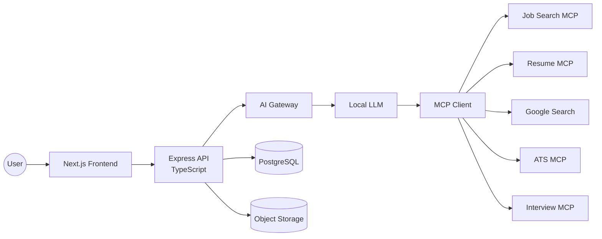
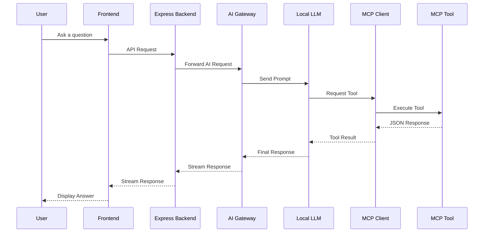
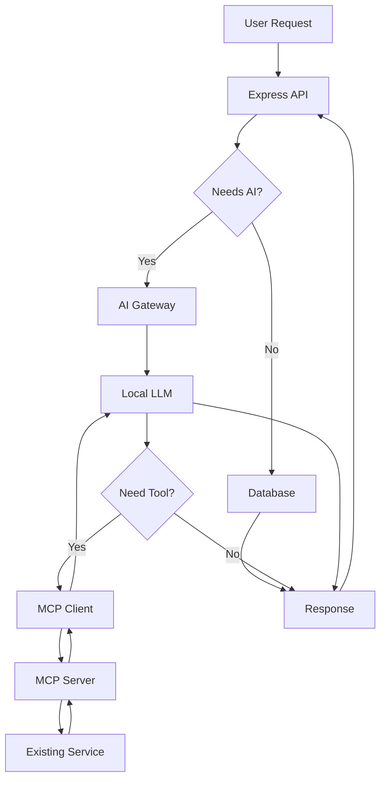
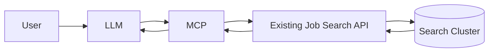
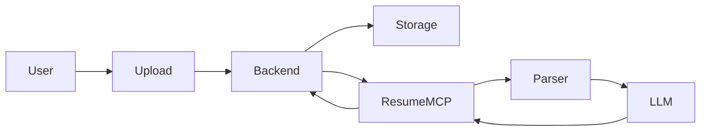
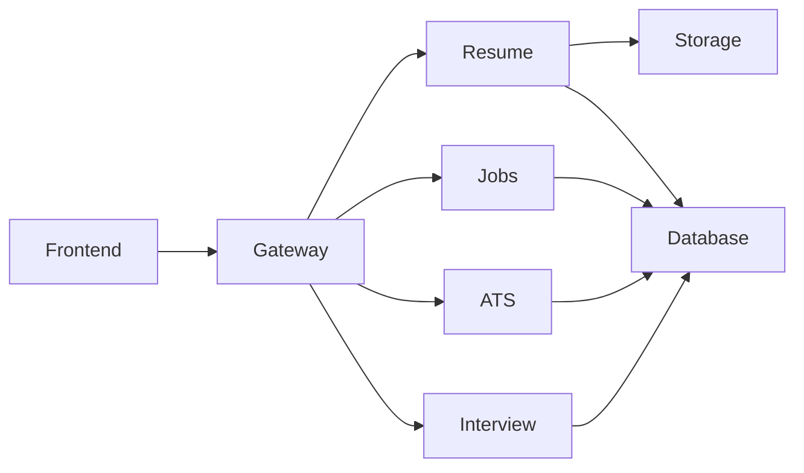

# CareerPilot AI — System Architecture Overview

**Version:** 1.0
**Status:** Draft
**Purpose:** High-Level Architecture Overview

---

# 1. Introduction

This document provides a high-level overview of the CareerPilot AI architecture. It explains how users interact with the platform, how requests flow through the system, and how different components communicate.

This document intentionally focuses on the overall system architecture. Detailed designs for individual modules (Resume Builder, AI Chat, ATS Analyzer, Job Search Integration, etc.) will be documented separately.

---

# 2. Architecture Goals

CareerPilot AI is designed around the following principles:

* AI-first architecture
* Modular components
* Independent services
* Easy feature expansion
* Local LLM support
* MCP (Model Context Protocol) based tool ecosystem
* Horizontally scalable
* Docker-first deployment

---

# 3. High-Level Architecture

---

# 4. System Components

## Frontend

Technology

* Next.js
* React
* TypeScript

Responsibilities

* User Interface
* Authentication
* Resume Upload
* Dashboard
* Chat Interface
* Job Explorer
* Interview Interface

The frontend never communicates directly with AI models or external services.

---

## Backend

Technology

* Express
* TypeScript

Responsibilities

* Authentication
* User Management
* Session Management
* Database Operations
* File Uploads
* Chat Session Storage
* API Gateway for Frontend

The backend acts as the entry point for every client request.

---

## AI Gateway

The AI Gateway is responsible for all AI interactions.

Responsibilities

* Conversation management
* Prompt construction
* Context injection
* MCP integration
* Tool execution
* Streaming responses
* Model abstraction

The frontend and backend never communicate directly with the LLM.

---

## Local LLM

The Local LLM is responsible for:

* Understanding user intent
* Deciding when tools are required
* Calling MCP tools
* Combining tool outputs into natural responses

The model never directly accesses databases or external APIs.

---

## MCP Layer

The Model Context Protocol (MCP) layer provides a standardized interface between the LLM and application capabilities.

Each feature is exposed as an independent MCP server.

Examples include:

* Job Search
* Resume
* ATS
* Interview
* GitHub
* Project Recommendation

This allows the LLM to use application features through a common protocol without being coupled to implementation details.

---

# 5. Request Lifecycle

---

# 6. User Interaction Flow

---

# 7. Example: Job Search

The job search engine already exists as an independent service.

The AI system interacts with it through MCP.

The AI never knows how jobs are indexed or searched.

It only invokes the appropriate MCP tool.

---

# 8. Example: Resume Analysis

---

# 9. Separation of Responsibilities

| Component         | Responsibility                    |
| ----------------- | --------------------------------- |
| Frontend          | User Interface                    |
| Express Backend   | Authentication, APIs, Persistence |
| AI Gateway        | AI orchestration                  |
| Local LLM         | Reasoning and tool selection      |
| MCP Client        | Tool communication                |
| MCP Servers       | Feature implementations           |
| Existing Services | Business logic                    |
| Database          | Persistent storage                |
| Object Storage    | Files and documents               |

---

# 10. Scalability Strategy

The architecture is designed so that every major capability can scale independently.

Each MCP server can be deployed independently.

Each backend service can be scaled horizontally using Docker.

This enables independent scaling based on workload.

---

# 11. Design Principles

* Frontend contains no business logic.
* Express acts as the single API entry point.
* AI interactions are isolated within the AI Gateway.
* The Local LLM communicates only through MCP.
* Every capability is implemented as an independent MCP server.
* Existing services are wrapped rather than rewritten.
* Components are loosely coupled and independently deployable.
* New AI capabilities can be added by introducing new MCP servers without changing the overall architecture.

---

# 12. Future Module Documents

This overview will be followed by detailed technical documentation for each subsystem:

1. Authentication & User Management
2. AI Gateway
3. MCP Architecture
4. Resume Builder
5. Resume Parser
6. ATS Analyzer
7. Job Search Integration
8. Project Recommendation Engine
9. Mock Interview
10. Voice Interview Assistant
11. Dashboard & Analytics
12. Database Design
13. Deployment & Infrastructure
14. Observability & Monitoring

Each document will define internal workflows, APIs, data models, deployment strategy, and implementation details for its respective module.
