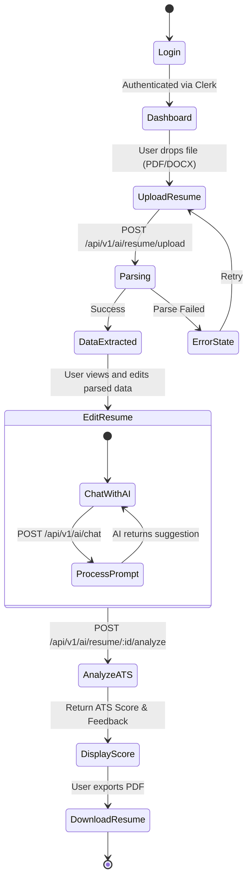
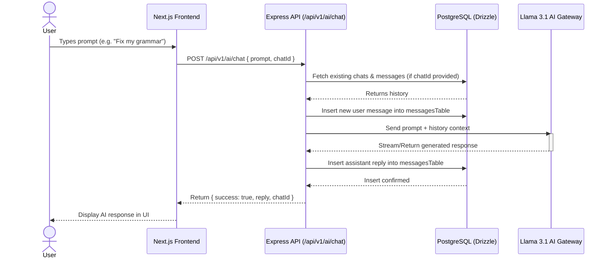
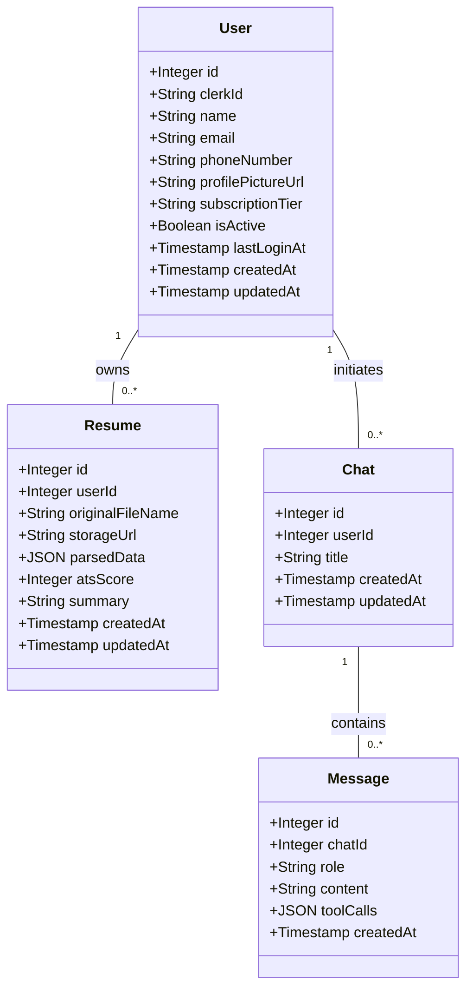
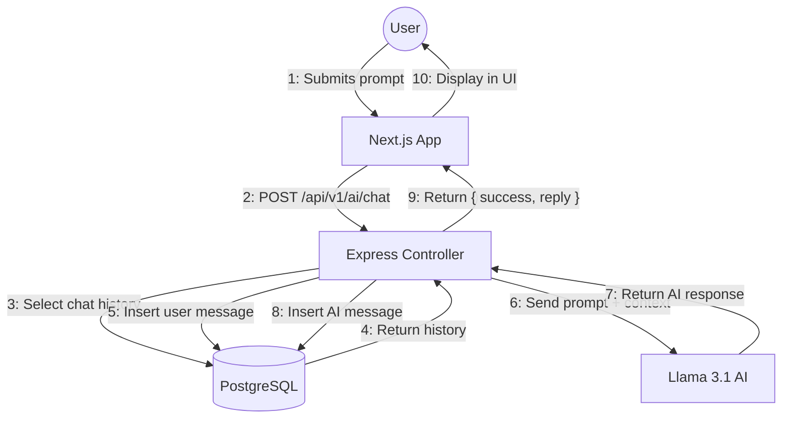

# UML Diagrams

## Project Overview

**CareerPilot AI** is an AI-powered Resume Intelligence Platform designed to help users create ATS-friendly resumes and evaluate their employability. 

**Main Technologies:**
- **Frontend:** React, Next.js, Tailwind CSS, React Query
- **Backend:** Node.js, Express, TypeScript, Clerk (Auth)
- **Database:** PostgreSQL (with Drizzle ORM), Redis
- **AI/Vector:** Self Hosted Llama 3.1 8B Instruct, Qdrant, RAG Pipeline

**Main Modules:**
- User Authentication (via Clerk)
- Resume Upload & Parsing
- AI Resume Generation & Chat Assistant
- ATS Analyzer
- Dashboard & Resume History

**Main Actors:**
- **User** (Job Seeker / Student)
- **Clerk Auth System**
- **AI Gateway / LLM**

**Main Workflow:**
Users register/login via Clerk, upload an existing resume which gets parsed and stored in the PostgreSQL database. The user can then interact with the AI assistant to rewrite summaries or experience, run an ATS analysis, and download the finalized resume.

---

## 1. Use Case Diagram

### Description
This diagram illustrates the main interactions a User has with the CareerPilot AI system, including external dependencies like Clerk Auth and the AI Engine.

### Diagram
```mermaid
usecaseDiagram
    actor User
    actor "Clerk Auth" as Clerk
    actor "Llama 3.1 AI Engine" as AI

    package "CareerPilot AI System" {
        usecase "Register/Login" as UC1
        usecase "View Dashboard" as UC2
        usecase "Upload Resume" as UC3
        usecase "Parse Resume Data" as UC4
        usecase "Edit Resume Data" as UC5
        usecase "Chat with AI Assistant" as UC6
        usecase "Analyze ATS Score" as UC7
        usecase "Download Resume (PDF/JSON/MD)" as UC8
        usecase "View Resume History" as UC9
    }

    User --> UC1
    User --> UC2
    User --> UC3
    User --> UC5
    User --> UC6
    User --> UC7
    User --> UC8
    User --> UC9

    UC1 --> Clerk : <<communicates>>
    UC3 ..> UC4 : <<include>>
    UC6 --> AI : <<communicates>>
    UC7 --> AI : <<communicates>>
    UC4 --> AI : <<communicates>>
```

### Explanation
The `User` is the primary actor who interacts with the dashboard to upload resumes, edit data, and request AI analysis. `Clerk Auth` handles the `Register/Login` use case as an external system. The `Llama 3.1 AI Engine` is responsible for parsing resumes, generating chat responses, and calculating the ATS score.

---

## 2. Activity Diagram

### Description
This activity diagram models the core workflow of uploading a resume, having it parsed by the backend, editing it, and generating an AI analysis.

### Diagram


### Explanation
The workflow starts with authentication. Once authenticated, the user uploads a document. If parsing succeeds, they can manually edit the form or interact with the AI Assistant to improve the content. After refinements, the user requests an ATS analysis and ultimately downloads the improved resume.

---

## 3. Sequence Diagram

### Description
This sequence diagram shows the technical interactions between the frontend, backend, database, and external AI services during the AI Resume Chat Assistant workflow.

### Diagram


### Explanation
The sequence follows the exact architecture described in the `frontend-tasks.md`. The user submits a prompt, which the Next.js frontend sends to the Express API. The API checks the database for chat history, stores the user's message, proxies the context to the Llama AI, stores the response back into PostgreSQL, and finally returns the data to the UI.

---

## 4. Class Diagram

### Description
This diagram represents the core Database schema and entity relationships defined in the Drizzle ORM `schema.ts`.

### Diagram


### Explanation
The data model revolves around the `User` entity (mapped to Clerk). A User can have multiple `Resume` records (storing the parsed JSON and ATS score) and multiple `Chat` sessions. Each `Chat` consists of multiple `Message` entities, keeping track of the user and assistant conversations.

---

## 5. Component Diagram

### Description
This diagram shows the high-level architecture of CareerPilot AI, demonstrating the separation of concerns between the Next.js frontend, Express API backend, and external dependencies.

### Diagram
```mermaid
componentDiagram
    package "Client Tier" {
        [Next.js App (Dashboard, Resume Builder)] as WebApp
    }

    package "API Tier" {
        [Express.js Server] as APIServer
        [Webhook Controller] as Webhooks
        [AI Controller] as AIController
        [Auth Middleware] as Auth
        
        APIServer --> Webhooks
        APIServer --> AIController
        APIServer --> Auth
    }

    package "Data Tier" {
        [PostgreSQL (Drizzle ORM)] as Database
    }

    package "External Services" {
        [Clerk Authentication] as ClerkService
        [Llama 3.1 8B Instruct] as LLM
        [Qdrant Vector DB] as Qdrant
    }

    WebApp --> Auth : Bearer Token Validation
    WebApp --> APIServer : REST API Calls
    WebApp --> ClerkService : OAuth/Login

    Auth --> ClerkService : Verify Token
    Webhooks --> ClerkService : Sync Users
    
    AIController --> LLM : Generate Content
    AIController --> Qdrant : RAG Context Retrieval
    APIServer --> Database : CRUD Operations
```

### Explanation
The system uses a 3-tier architecture. The Next.js frontend communicates with the Express backend, which relies on Clerk for auth and webhooks. The backend controllers talk to PostgreSQL for structured data and external AI services (Llama + Qdrant) for resume intelligence.

---

## 6. Deployment Diagram

### Description
This diagram maps out the expected runtime environment of CareerPilot AI based on the `docker/` folder and local architecture mentions in the PRD.

### Diagram
```mermaid
deploymentDiagram
    node "User Device" {
        node "Web Browser" {
            artifact "Next.js Frontend (React)"
        }
    }

    node "Cloud Infrastructure" {
        node "App Server Container" {
            artifact "Node.js Express API"
        }
        
        node "Database Server Container" {
            database "PostgreSQL"
        }

        node "AI Server Container" {
            artifact "Llama 3.1 Engine"
            database "Qdrant Vector Store"
        }
    }
    
    cloud "External SaaS" {
        node "Clerk"
    }

    "Web Browser" -- "Next.js Frontend (React)"
    "Next.js Frontend (React)" ..> "Node.js Express API" : HTTPS/REST
    "Next.js Frontend (React)" ..> "Clerk" : HTTPS
    "Node.js Express API" ..> "PostgreSQL" : TCP/5432
    "Node.js Express API" ..> "Llama 3.1 Engine" : REST/gRPC
    "Node.js Express API" ..> "Qdrant Vector Store" : TCP
```

### Explanation
The frontend runs in the User's browser. The backend logic, relational database, and AI systems are deployed in containers (likely Docker, as suggested by the repo structure). External authentication is handled by Clerk's SaaS platform.

---

## 7. Communication Diagram

### Description
This communication diagram visualizes the same Chat Assistant interaction as the Sequence diagram, but focuses on the structural links and sequence of messages between the system's objects.

### Diagram

*(Note: Mermaid flowchart is used to represent the UML Communication Diagram as Mermaid does not have a dedicated Communication Diagram syntax, but a numbered flowchart perfectly captures the required topology and sequence).*

### Explanation
The numbered links trace the message flow: from the user input on the frontend, down to the controller, the database queries, out to the AI service, and all the way back to the user interface.

---

## 8. Object Diagram

### Description
This object diagram provides a snapshot of the instantiated entities during an active session where a user is refining their resume and has started a chat session.

### Diagram
```mermaid
classDiagram
    object user1 {
        id = 101
        clerkId = "user_2aXb3"
        name = "John Doe"
        email = "john@example.com"
        subscriptionTier = "FREE"
    }

    object resume1 {
        id = 505
        userId = 101
        originalFileName = "John_Doe_Resume_V1.pdf"
        atsScore = 72
        summary = "Experienced software engineer..."
    }

    object chat1 {
        id = 302
        userId = 101
        title = "Summary Improvement"
    }

    object msg1 {
        id = 801
        chatId = 302
        role = "user"
        content = "Make my summary sound more professional."
    }

    object msg2 {
        id = 802
        chatId = 302
        role = "assistant"
        content = "Here is a refined version: A highly motivated software engineer..."
    }

    user1 -- resume1 : owns
    user1 -- chat1 : owns
    chat1 -- msg1 : contains
    chat1 -- msg2 : contains
```

### Explanation
The snapshot displays `user1` (John Doe), who has uploaded `resume1` (currently scoring 72). They have initiated `chat1` to improve their summary, which contains two `Message` instances (`msg1` and `msg2`) representing the request and the AI's response. All relationships align directly with the definitions in `schema.ts`.

---

## Final Summary
- **Analyzed Artifacts:** The `README.md`, `schema.ts`, and `frontend-tasks.md`.
- **Selected Workflow:** The "AI Chat Assistant" and "Resume Upload/Analyze" workflows were used for the Activity, Sequence, and Communication diagrams as they are the core focus of Phase 1 MVP.
- **Major Classes Used:** Entities directly from the `schema.ts` (Users, Resumes, Chats, Messages).
- **Assumptions:** Since Docker configurations and exact server deployment specifics were not implemented in the current code files, the Deployment Diagram was inferred from the `README.md` repository structure (`docker/` directory) and standard Node.js/React cloud patterns. Mermaid flowcharts were used as an accepted alternative for UML Communication diagrams, as Mermaid lacks native communication diagram support.
