# CareerPilot AI — User Flows & Application Navigation

**Version:** 1.0  
**Status:** Draft  
**Purpose:** Define the end-to-end user journeys, navigation structure, and feature workflows within CareerPilot AI.

---

# 1. Introduction

This document describes how users interact with CareerPilot AI from the moment they land on the platform until they complete various career development tasks.

Unlike the System Architecture document, this guide focuses on the **user experience** rather than the internal implementation. It outlines navigation paths, onboarding, feature-specific workflows, and dashboard interactions.

---

# 2. User Journey Overview

The following diagram illustrates the primary navigation path throughout the application.

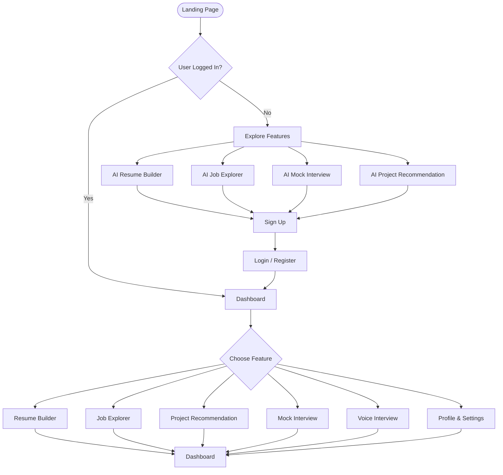

---

# 3. Landing Page Flow

The landing page serves as the entry point for all users.

Users can:

- Learn about CareerPilot AI
- Explore features
- View pricing
- Read testimonials
- Try demo experiences
- Register or log in

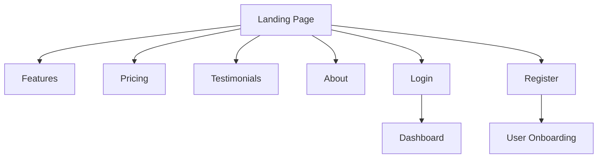

---

# 4. User Onboarding Flow

New users complete an onboarding process to personalize AI recommendations.

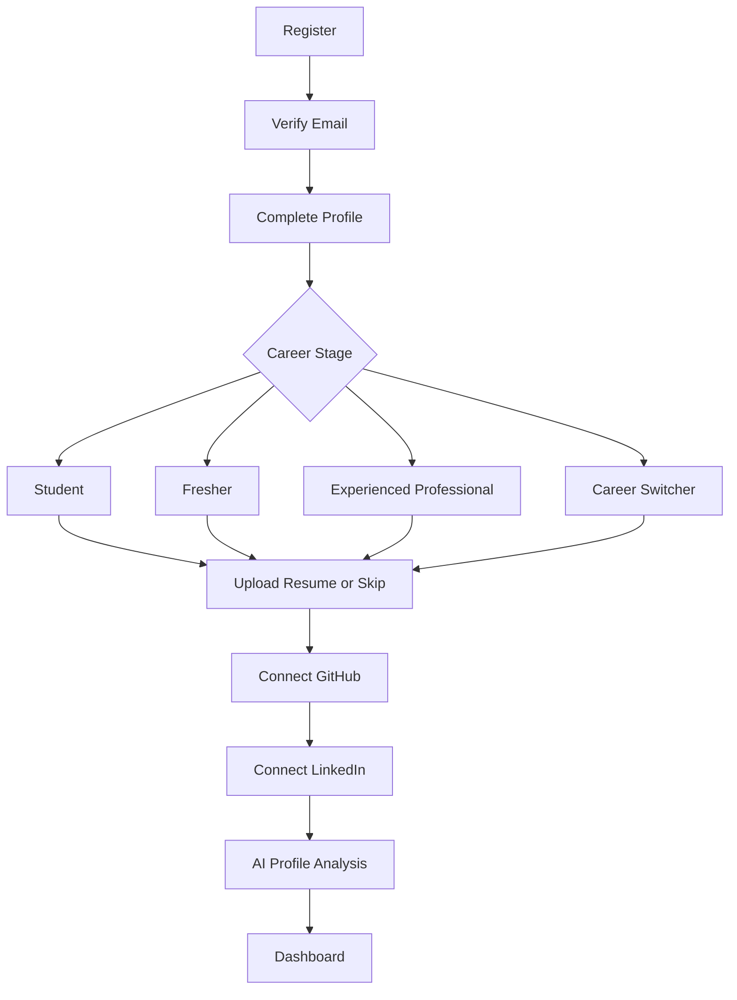

---

# 5. Dashboard Navigation

The dashboard acts as the central hub for every feature.

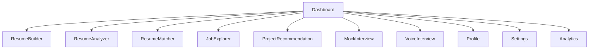

---

# 6. AI Resume Builder Flow

Users can create or improve resumes using multiple data sources.

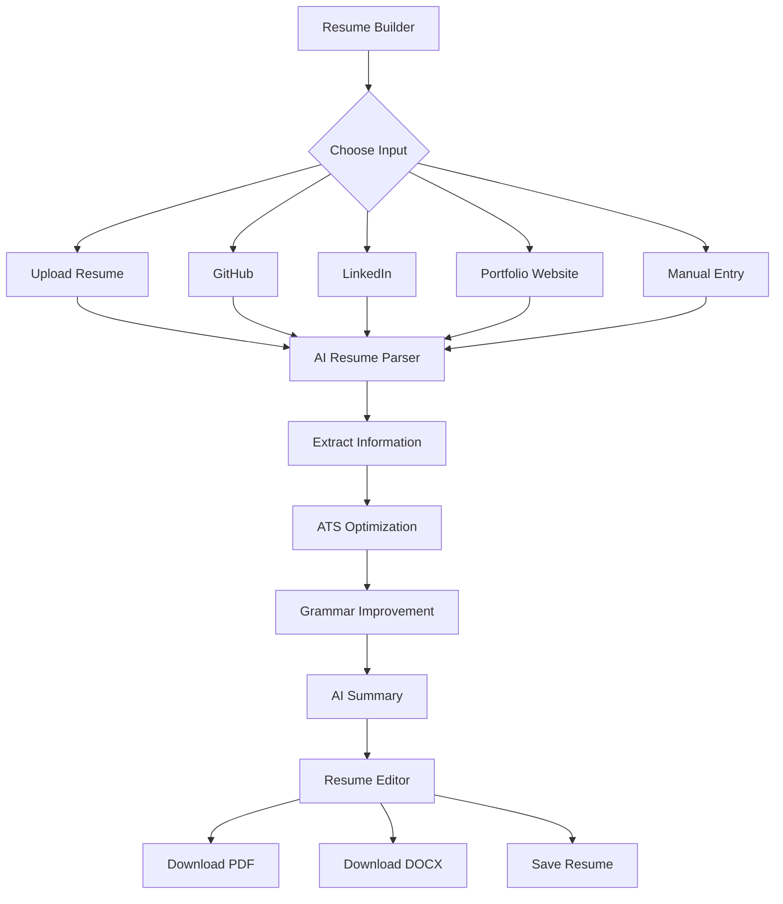

---

# 7. Resume vs Job Description Flow

Users compare resumes against job descriptions.

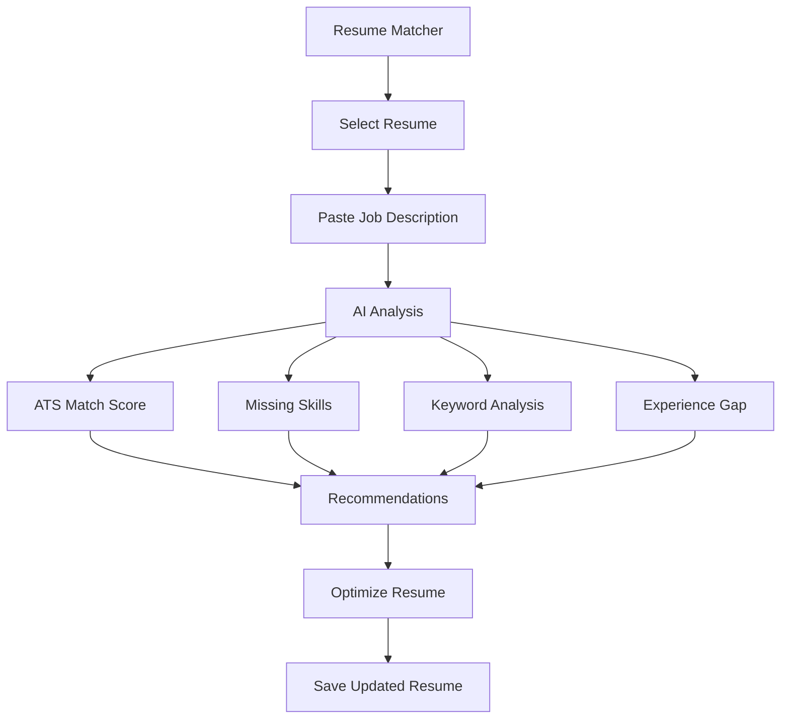

---

# 8. AI Job Explorer Flow

Users discover jobs and internships tailored to their profile.

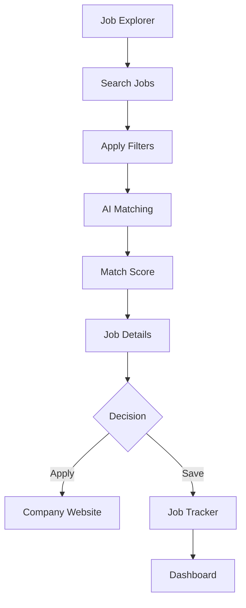

---

# 9. AI Project Recommendation Flow

CareerPilot AI recommends projects based on the user's skills and experience.

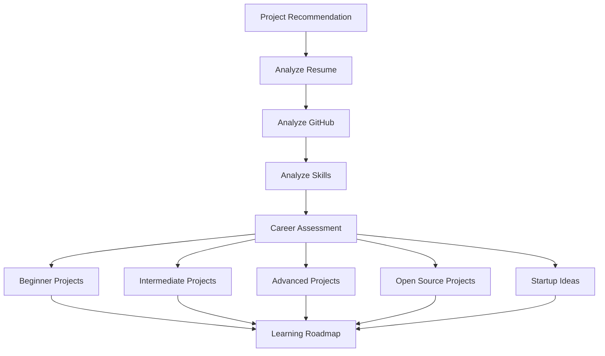

---

# 10. AI Mock Interview Flow

Users practice interviews with AI.

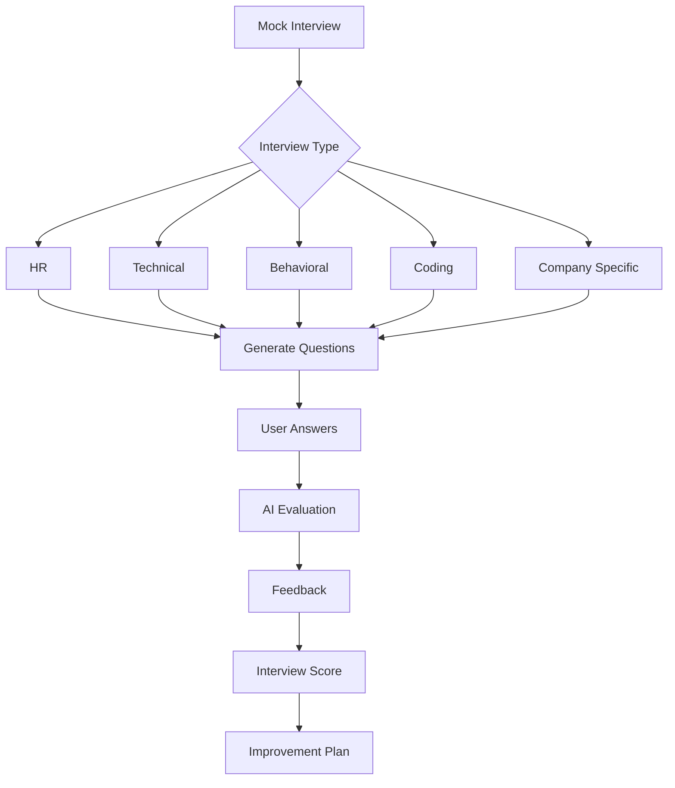

---

# 11. Voice Interview Flow

Users conduct real-time voice interviews with AI.

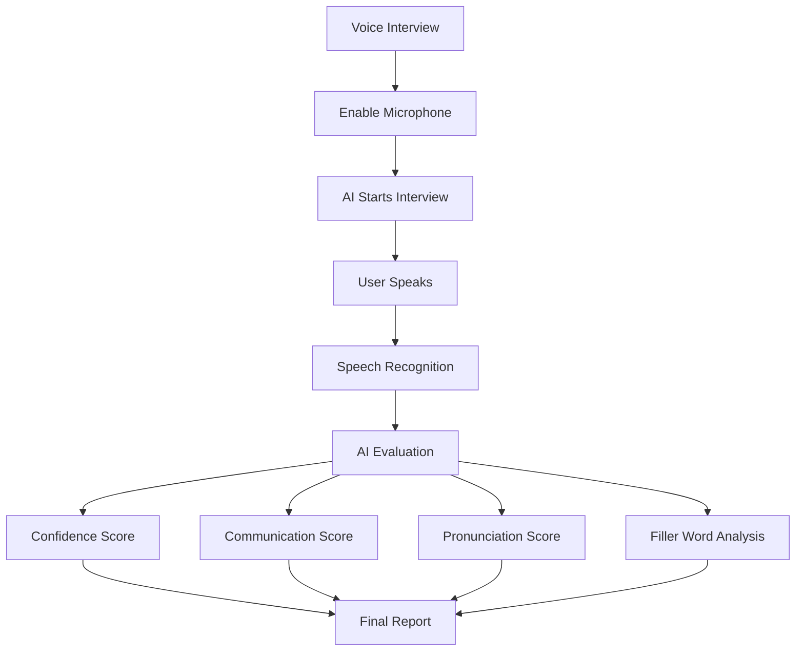

---

# 12. Dashboard Analytics Flow

The dashboard summarizes the user's career progress.

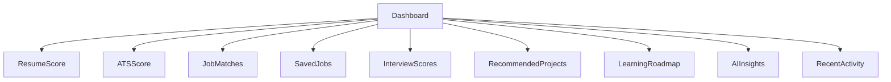

---

# 13. Profile & Settings Flow

Users manage their personal information and connected accounts.

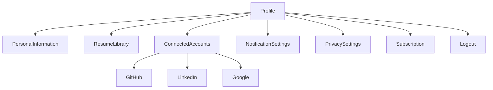

---

# 14. Complete Feature Navigation

The following diagram illustrates how all major modules are interconnected.

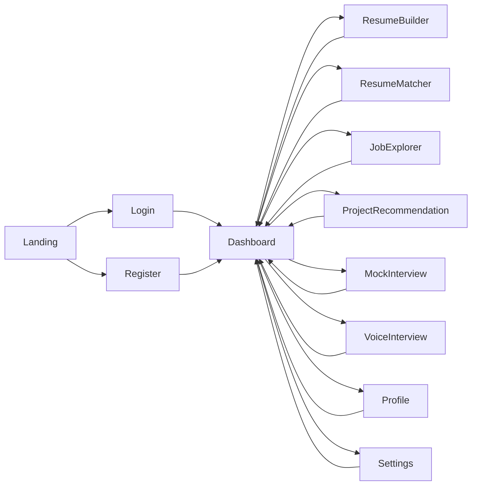

---

# 15. User Journey Summary

A typical user journey through CareerPilot AI is as follows:

1. User visits the landing page.
2. Explores platform features.
3. Registers or logs in.
4. Completes onboarding.
5. Uploads or creates a resume.
6. Receives AI-powered ATS optimization.
7. Searches for jobs and internships.
8. Compares resume with job descriptions.
9. Receives personalized project recommendations.
10. Practices interviews using AI.
11. Reviews performance on the dashboard.
12. Continuously improves employability through AI recommendations.

---

# 16. Future User Flows

The following workflows will be documented as new features are introduced:

- Module 5 — AI Voice Interview Assistant *(Future Release)*
- AI Career Coach
- Daily Learning Planner
- Coding Practice Assistant
- Company Preparation Workflows
- Resume Version Management
- Job Application Pipeline
- Networking Assistant
- Mentor Recommendations
- AI Career Roadmap
- Team & Institution Dashboards
- Recruiter Portal
- Placement Cell Portal
- Mobile Application Navigation